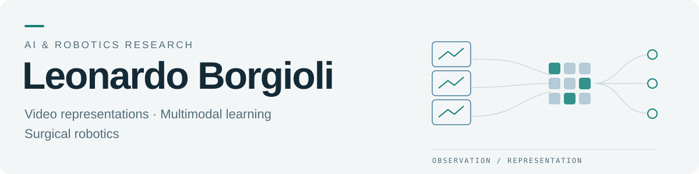

<picture>
  <source media="(prefers-color-scheme: dark)" srcset="assets/header-dark.svg">
  <source media="(prefers-color-scheme: light)" srcset="assets/header-light.svg">
  
</picture>

  <a href="https://borgioli.github.io/Portfolio/"><strong>Portfolio</strong></a> &nbsp; · &nbsp;
  <a href="https://scholar.google.com/citations?user=Gir5HwMAAAAJ&amp;hl=en">Google Scholar</a> &nbsp; · &nbsp;
  <a href="https://orcid.org/0009-0004-8653-8158">ORCID</a> &nbsp; · &nbsp;
  <a href="https://www.linkedin.com/in/leonardo-borgioli-474763171/">LinkedIn</a> &nbsp; · &nbsp;
  <a href="https://borgioli.github.io/Portfolio/assets/Leonardo_Borgioli_CV.pdf">CV</a>

### Research

I am a **PhD candidate in Electrical and Computer Engineering at the University of Illinois Chicago** and an **AI and HPC research intern at Argonne National Laboratory**.

My research focuses on self-supervised video representation learning and multimodal models for surgical robotics and scientific applications. I study how learned representations transfer across domains and tasks, and develop training and evaluation methods for video models.

- **Video foundation models:** surgical pretraining, representation transfer, and downstream evaluation.
- **Multimodal learning:** joint modeling of video, sensor measurements, and temporal dynamics.
- **Surgical robotics:** perception, human–robot interfaces, and synchronized surgical datasets.

### Selected research

| Project | Research focus | Resources |
| :--- | :--- | :--- |
| **OmniRAS** | Foundation model training and evaluation for robot-assisted surgery, with surgical video encoders and benchmarks. | [Code](https://github.com/Borgioli/omniras) · [Paper](https://arxiv.org/abs/2608.31048) · [Project](https://borgioli.github.io/omniras/) |
| **When Self-Supervision Transfers** | Transfer of visual representations between laparoscopic and robotic surgery. | [Experiment scripts](https://github.com/Borgioli/Transfer_lapa_robo) · [Overview](https://borgioli.github.io/Portfolio/#research) |
| **CRCD** | Robotic cholecystectomy data combining endoscopic video, robot kinematics, and pedal signals. | [Repository](https://github.com/SITL-Eng/CRCD) · [Dataset](https://huggingface.co/datasets/SITL-Eng/CRCD) · [Paper](https://arxiv.org/abs/2412.12238) |
| **Sensory-glove interface** | Hand tracking, gesture clutching, and vibrotactile feedback for a surgical robot interface. | [Paper](https://arxiv.org/abs/2403.13941) · [Demo](https://borgioli.github.io/Portfolio/#projects) · [Course project](https://github.com/Borgioli/Robotic-Assisted-Sensory-Glove-Interface) |

### Methods and systems

**Learning:** PyTorch · self-supervised learning · video transformers · multimodal fusion 
**Robotics:** computer vision · ROS · da Vinci Research Kit · surgical perception 
**Computing:** Python · C/C++ · distributed training · high-performance computing

### Contact

For research collaborations and academic or industry opportunities: **[lborgi2@uic.edu](mailto:lborgi2@uic.edu)**.

Project demonstrations and further research descriptions are available in my [portfolio](https://borgioli.github.io/Portfolio/); publications are listed on [Google Scholar](https://scholar.google.com/citations?user=Gir5HwMAAAAJ&hl=en).
